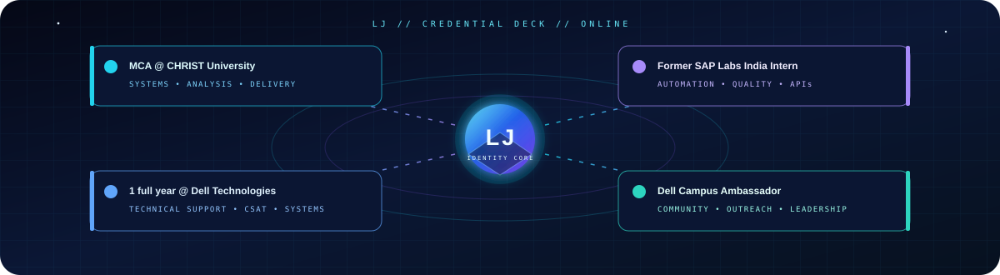
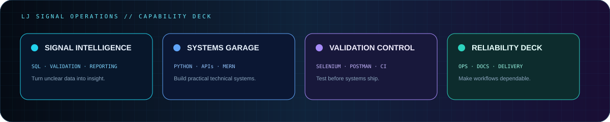
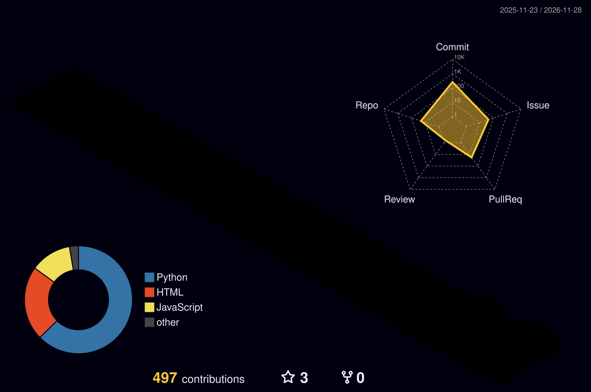

 

### Data & Business Analysis · Technical Solutions · Quality Engineering

<strong>MCA @ CHRIST University</strong> · <strong>1 full year @ Dell Technologies</strong> · <strong>Former SAP Labs India Intern</strong> · <strong>Dell Campus Ambassador</strong>

  
  
  

`ANALYZE` · `DESIGN` · `VALIDATE` · `DELIVER`

<a href="#engineering-identity">IDENTITY</a> · <a href="#signal-garage">MISSION FLEET</a> · <a href="#capability-matrix">SIGNAL LAB</a> · <a href="#professional-flight-record">CAREER TELEMETRY</a> · <a href="#proof-of-work-signals">EVIDENCE CONSOLE</a> · <a href="#open-channel">OPEN CHANNEL</a>

<strong>NOW // ACTIVE SIGNAL</strong> 
<code>Data & Business Analysis</code> · <code>Technical Solutions</code> · <code>Quality Engineering</code> · <code>Systems in motion</code>

---

## Project Multiverse

Each world represents a practical system built around a different operational problem: customer-experience intelligence, academic workflows, delivery visibility, commerce operations, and interactive browser experiences.

## Engineering Identity

I work at the intersection of **business insight, technical operations, and quality engineering**—turning unclear signals into dependable workflows, testable APIs, and practical software systems.

| Focus | What I bring |
|---|---|
| Business & Data Analysis | SQL, validation, reporting, workflow mapping, and decision-ready insight |
| Technical Solutions | Python, Java, JavaScript, REST APIs, MERN systems, and troubleshooting |
| Quality Engineering | Selenium, Postman, API validation, debugging, test coverage, and CI checks |
| Technical Operations | One full year at Dell Technologies, incident resolution, documentation, CSAT, and stakeholder communication |

---

## Flagship System — CarePulse

**CarePulse** is a synthetic, industry-neutral customer-experience intervention prototype. It connects customer signals, data-quality validation, explainable risk scoring, recovery workflows, and executive insight.

| System layer | What it demonstrates |
|---|---|
| Experience intelligence | Silent-wait, customer-effort, experience-risk, recovery, and next-best-care calculations |
| Data and analytics | Fixed-seed synthetic datasets, SQL learning queries, exports, Power BI assets, and validation workflows |
| Application architecture | FastAPI, Jinja, SQLAlchemy, SQLite demo mode, and PostgreSQL-compatible configuration |
| Quality and security | Role checks, organisation-scoped records, configurable thresholds, audit events, tests, and CI |
| Integration | APIs, Postman collection, Java/Selenium starter suite, and event-driven simulation |

  

---

## Supporting Project Worlds

| World | System focus | Technology and outcome |
|---|---|---|
| **Student LMS** | Academic records and student workflows | React · Node.js · Express · MongoDB · CRUD APIs |
| **Student Project Tracker** | Delivery status and structured project records | Tracking workflows · validation · project visibility |
| **Diamond Commerce** | Product and order operations | Authentication · catalogue · cart · inventory · admin |
| **Dell Trivia Arena** | Interactive browser experience | JavaScript · HTML · CSS · branching question logic |

  
  
  

---

## Interactive Mission — Multiverse Signal Runner

**Collect trusted signals. Validate anomalies. Restore the Bengaluru data grid.** Pilot the LJ Signal Drone through a cinematic data-quality mission designed around analytics, technical operations, automation, and quality engineering.

| System layer | Technical signal |
|---|---|
| Architecture | Dependency-free ES modules · Canvas 2D · separated domain engine |
| Quality | 6 native Node.js tests covering scoring, hazards, validation, missions, and rank |
| Analytics | Live integrity · coverage · insight · signal · combo · high-score telemetry |
| Game logic | Collision model · validation pulse · boost state · mission progression · accessibility-aware controls |
| Delivery | GitHub Actions CI · GitHub Pages deployment · responsive keyboard and touch controls |

---

## Signal Garage

A visual project lane for systems that move from an unclear problem to a tested, deployable result.

<strong>🏁 CAREPULSE // CUSTOMER-EXPERIENCE INTELLIGENCE</strong>

**Problem:** Convert customer signals into explainable intervention workflows.  
**Architecture:** FastAPI · Jinja · SQLAlchemy · SQLite demo mode · PostgreSQL-ready configuration.  
**Validation:** SQL workflows · Postman integration · tests · role checks · audit events.  
**Outcome:** A practical analytics and quality-engineering prototype.

[Open CarePulse](https://github.com/Lokrajjoshi/CarePulse)

<strong>⚡ SIGNAL RUNNER // DATA-QUALITY MISSION</strong>

**Problem:** Make validation and data-quality concepts interactive.  
**Architecture:** Dependency-free ES modules · Canvas 2D · separated game engine · GitHub Pages.  
**Validation:** Six native Node.js tests · collision logic · mission progression · telemetry.  
**Outcome:** A live playable engineering demonstration.

[Play Signal Runner](https://lokrajjoshi.github.io/multiverse-signal-runner/) · [View source](https://github.com/Lokrajjoshi/multiverse-signal-runner)

<strong>🛰️ PROJECT TRACKER // DELIVERY VISIBILITY</strong>

**Problem:** Make scattered student delivery work visible and structured.  
**Architecture:** CRUD-oriented tracking workflows with validation and project-status visibility.  
**Outcome:** A practical project-management system for academic delivery.

[Open Student Project Tracker](https://github.com/Lokrajjoshi/CIA3-Student-Tracker-System)

<strong>🧠 STUDENT LMS // ACADEMIC SYSTEMS</strong>

**Problem:** Support academic records and student workflows.  
**Architecture:** React · Node.js · Express · MongoDB · CRUD APIs.  
**Outcome:** A full-stack academic workflow implementation.

[Open Student LMS](https://github.com/Lokrajjoshi/joshi-lms-react)

<strong>🏎️ DELL TRIVIA // INTERACTIVE FRONTEND</strong>

**Problem:** Turn product knowledge into an engaging browser experience.  
**Architecture:** JavaScript · HTML · CSS · branching question logic.  
**Outcome:** A compact interactive frontend system.

[Open Dell Trivia Game](https://github.com/Lokrajjoshi/dell-trivia-game)

---

## Capability Matrix

<table>
<tr>
<td width="25%" valign="top">

### Analysis

SQL  
Data validation  
Business workflows  
Risk and quality signals  
Reporting and insight

</td>
<td width="25%" valign="top">

### Systems

Python  
Java  
JavaScript  
REST APIs  
MERN applications

</td>
<td width="25%" valign="top">

### Quality

Selenium  
Postman  
API testing  
Debugging  
Test coverage

</td>
<td width="25%" valign="top">

### Delivery

Git and GitHub  
Technical support  
Documentation  
Stakeholder communication  
Process improvement

</td>
</tr>
</table>

  

---

## Professional Flight Record

| Mission | Role | Impact |
|---|---|---|
| **CHRIST (Deemed to be University), Bengaluru** | MCA Candidate | Building capability across analytics, business workflows, software systems, and quality engineering |
| **Dell Technologies** | Senior Technician · 1 full year | Resolved hardware, software, OS, and connectivity issues; maintained technical documentation; achieved **100% CSAT for two quarters** |
| **SAP Labs India** | Automation Testing Intern | Automated API test scenarios, validated responses, debugged failures, and improved test maintainability using Java, Postman, Git, IntelliJ, and Selenium |
| **Prinston Smart Engineers** | Full-Stack Web Development Intern | Built responsive React pages, Node.js APIs, authentication, cart, filtering, inventory, admin, and order workflows |
| **InternPe** | Python Intern | Developed Python automation and file-handling scripts; worked with debugging and data manipulation |
| **Dell Technologies** | Campus Ambassador | Represented Dell through campus outreach, workshops, student engagement, and collaboration |

<strong>Leadership, learning, and beyond</strong>

 

- Class Representative / Event Coordinator at CHRIST (Deemed to be University)
- Crash Course on Python — Coursera
- Introduction to Hardware and Operating Systems — Coursera
- CCNA, Software Testing, and Full-Stack Web Development
- Football player, Karate practitioner, and trekking enthusiast

---

## Live Activity Layer

### 3D Contribution World

  

### Contribution Snake

  

---

## Proof-of-Work Signals

  

`TESTED` · `VALIDATED` · `DOCUMENTED` · `DEPLOYED`

- **Testing:** Selenium, Postman, API validation, native Node.js tests, debugging, and regression checks
- **Data workflows:** SQL learning queries, fixed-seed datasets, exports, validation rules, and reporting assets
- **Delivery:** GitHub Actions CI, GitHub Pages deployment, responsive controls, and reduced-motion support
- **Architecture:** FastAPI, MERN, Canvas 2D, REST APIs, SQLite demo mode, and PostgreSQL-compatible configuration

---

## Open Channel

**Interested in data, business analysis, technical operations, quality engineering, and practical software systems.**

  

`SYSTEM STATUS: EXPLORING · BUILDING · IMPROVING`

