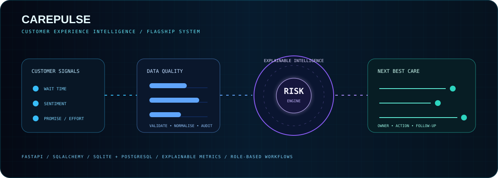
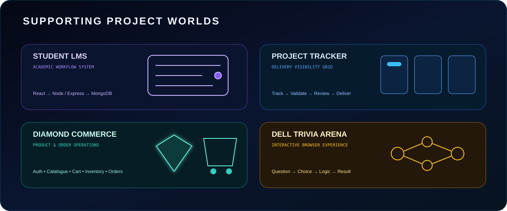

 

### Data & Business Analysis · Technical Solutions · Quality Engineering

<strong>MCA @ CHRIST University</strong> · <strong>1 full year @ Dell Technologies</strong> · <strong>Former SAP Labs India Intern</strong> · <strong>Dell Campus Ambassador</strong>

  
  
  

`ANALYZE` · `DESIGN` · `VALIDATE` · `DELIVER`

---

## Project Multiverse

Each world represents a practical system built around a different operational problem: customer-experience intelligence, academic workflows, delivery visibility, commerce operations, and interactive browser experiences.

---

## Flagship System — CarePulse

**CarePulse** is a synthetic, industry-neutral customer-experience intervention prototype. It connects customer signals, data-quality validation, explainable risk scoring, recovery workflows, and executive insight.

| System layer | What it demonstrates |
|---|---|
| Experience intelligence | Silent-wait, customer-effort, experience-risk, recovery, and next-best-care calculations |
| Data and analytics | Fixed-seed synthetic datasets, SQL learning queries, exports, Power BI assets, and validation workflows |
| Application architecture | FastAPI, Jinja, SQLAlchemy, SQLite demo mode, and PostgreSQL-compatible configuration |
| Quality and security | Role checks, organisation-scoped records, configurable thresholds, audit events, tests, and CI |
| Integration | APIs, Postman collection, Java/Selenium starter suite, and event-driven simulation |

  

---

## Supporting Project Worlds

| World | System focus | Technology and outcome |
|---|---|---|
| **Student LMS** | Academic records and student workflows | React · Node.js · Express · MongoDB · CRUD APIs |
| **Student Project Tracker** | Delivery status and structured project records | Tracking workflows · validation · project visibility |
| **Diamond Commerce** | Product and order operations | Authentication · catalogue · cart · inventory · admin |
| **Dell Trivia Arena** | Interactive browser experience | JavaScript · HTML · CSS · branching question logic |

  
  
  

---

## Interactive Mission — Multiverse Signal Runner

**Collect trusted signals. Validate anomalies. Restore the Bengaluru data grid.** Pilot the LJ Signal Drone through a cinematic data-quality mission designed around analytics, technical operations, automation, and quality engineering.

| System layer | Technical signal |
|---|---|
| Architecture | Dependency-free ES modules · Canvas 2D · separated domain engine |
| Quality | 6 native Node.js tests covering scoring, hazards, validation, missions, and rank |
| Analytics | Live integrity · coverage · insight · signal · combo · high-score telemetry |
| Game logic | Collision model · validation pulse · boost state · mission progression · accessibility-aware controls |
| Delivery | GitHub Actions CI · GitHub Pages deployment · responsive keyboard and touch controls |

---

## Capability Matrix

<table>
<tr>
<td width="25%" valign="top">

### Analysis

SQL  
Data validation  
Business workflows  
Risk and quality signals  
Reporting and insight

</td>
<td width="25%" valign="top">

### Systems

Python  
Java  
JavaScript  
REST APIs  
MERN applications

</td>
<td width="25%" valign="top">

### Quality

Selenium  
Postman  
API testing  
Debugging  
Test coverage

</td>
<td width="25%" valign="top">

### Delivery

Git and GitHub  
Technical support  
Documentation  
Stakeholder communication  
Process improvement

</td>
</tr>
</table>

  

---

## Professional Flight Record

| Mission | Role | Impact |
|---|---|---|
| **CHRIST (Deemed to be University), Bengaluru** | MCA Candidate | Building capability across analytics, business workflows, software systems, and quality engineering |
| **Dell Technologies** | Senior Technician · 1 full year | Resolved hardware, software, OS, and connectivity issues; maintained technical documentation; achieved **100% CSAT for two quarters** |
| **SAP Labs India** | Automation Testing Intern | Automated API test scenarios, validated responses, debugged failures, and improved test maintainability using Java, Postman, Git, IntelliJ, and Selenium |
| **Prinston Smart Engineers** | Full-Stack Web Development Intern | Built responsive React pages, Node.js APIs, authentication, cart, filtering, inventory, admin, and order workflows |
| **InternPe** | Python Intern | Developed Python automation and file-handling scripts; worked with debugging and data manipulation |
| **Dell Technologies** | Campus Ambassador | Represented Dell through campus outreach, workshops, student engagement, and collaboration |

<strong>Leadership, learning, and beyond</strong>

 

- Class Representative / Event Coordinator at CHRIST (Deemed to be University)
- Crash Course on Python — Coursera
- Introduction to Hardware and Operating Systems — Coursera
- CCNA, Software Testing, and Full-Stack Web Development
- Football player, Karate practitioner, and trekking enthusiast

---

## Live Activity Layer

### 3D Contribution World

  

### Contribution Snake

  

---

## Open Channel

**Interested in data, business analysis, technical operations, quality engineering, and practical software systems.**

  

`SYSTEM STATUS: EXPLORING · BUILDING · IMPROVING`

